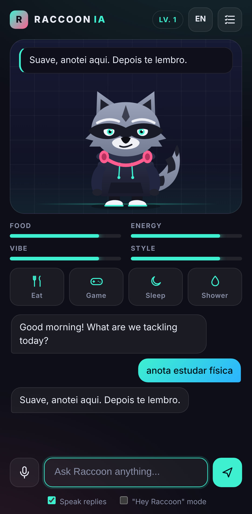
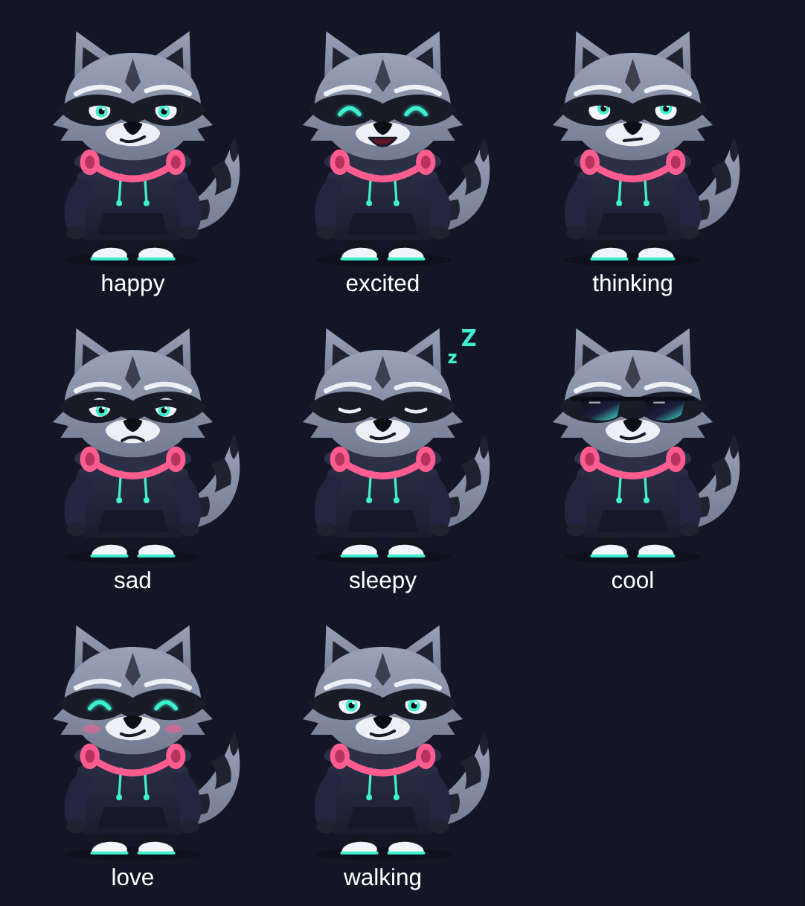

# Raccoon IA



Um guaxinim virtual com inteligência artificial (Claude) que **fica na sua tela**, no PC e no celular.
É parte bichinho virtual (estilo tamagotchi), parte assistente pessoal, e entende **voz em português e inglês**.

- **Visual streetwear**: moletom, fone no pescoço, tênis, olhar de boa e óculos escuros quando manda bem.
- **Fica na tela**: no PC ele anda pela parte de baixo da tela, por cima das outras janelas. No Android vira uma
  bolha flutuante por cima dos outros apps.
- **Assistente**: responde perguntas, ajuda nos estudos e no trabalho, cria tarefas e lembretes.
- **Tamagotchi**: fome, energia, vibe e estilo caem com o tempo. Dá pra dar comida, jogar, dormir e tomar banho, e ele sobe de nível.
- **Google Agenda**: "o que eu tenho hoje?", "marca dentista quinta às 15h". Ele também avisa uns 10 minutos antes de cada compromisso ([como conectar](docs/google-agenda.md)).
- **Voz**: botão do microfone ou modo mãos-livres "Ei Raccoon", com as respostas faladas no idioma em que você falou.

<br clear="right"/>



## Onde ele roda

| Plataforma | Como | Guaxinim fora do app | Voz |
|---|---|---|---|
| **Windows / macOS / Linux** | app desktop (`desktop/`, Electron) | anda pela tela, sempre por cima | Whisper local (offline, baixa ~80 MB na 1ª vez) |
| **Android** | app nativo (`android/`) | bolha flutuante sobre outros apps | reconhecimento de voz do próprio Android |
| **Navegador / iPhone** | PWA (abre no navegador e instala) | não: o iOS não deixa apps desenharem por cima de outros | Web Speech (Chrome, Edge, Safari) |

## Começando

Precisa de **Node.js 20+** e de uma chave da API do Claude (https://console.anthropic.com).

### PC: app desktop (recomendado)

```bash
npm install
npm run desktop
```

Na primeira vez ele pede a chave da API (fica salva no seu computador). O guaxinim aparece no canto inferior da tela:
- **arrastar** move o guaxinim; **clique** faz carinho; **duplo clique** abre o app
- passe o mouse em cima para ver os botões: falar, perguntar, comer, abrir o app
- **botão direito** abre o menu: andar pela tela, iniciar com o computador, sair
- fechar a janela principal não fecha o app: ele continua na bandeja do sistema

**Instalador:** `npm run build:win` (ou `build:mac` / `build:linux`) gera o instalador em `dist/`.
Também dá para gerar no GitHub: **Actions → Build apps → Run workflow**. Ele gera `.exe` (Windows), `.dmg` (Mac) e `.apk` (Android).

### Celular Android

1. No PC, rode o servidor: `cp .env.example .env` (coloque a chave) e depois `npm start`.
   O terminal mostra o endereço para o celular, tipo `http://192.168.0.10:3000`.
2. Instale `downloads/RaccoonIA-android.apk` no celular (permita "instalar apps de fontes desconhecidas").
3. Abra o app, digite o endereço do servidor e toque no ícone de tela no topo para soltar o guaxinim na tela
   (o Android pede a permissão "sobrepor a outros apps").

Para usar fora do Wi-Fi de casa, publique o servidor (Render, Railway, Fly.io, um VPS...) e use esse endereço.

### Navegador

```bash
npm start   # http://localhost:3000
```

### Google Agenda

Precisa criar uma chave grátis no Google Cloud uma vez (~5 min) e conectar pelo computador:
passo a passo em **[docs/google-agenda.md](docs/google-agenda.md)**.

## Estrutura

```
server/       servidor: ponte com a API do Claude (streaming), personalidade, ferramentas e Google Agenda
public/       app web (também usado dentro do desktop e do Android)
  raccoon.js / raccoon.css   o guaxinim em SVG + animações e expressões
  app.js                     tamagotchi, chat, tarefas, lembretes
  companion.html / .js       o guaxinim "solto" na tela (desktop e bolha do Android)
  voice.js                   voz: Android nativo, Whisper (desktop) ou Web Speech (navegador)
desktop/      app Electron: janela transparente, passeio pela tela, bandeja
android/      app Android (Java): WebView + bolha flutuante + voz nativa
```

## Observações

- A chave da API fica só no servidor ou no app desktop, nunca vai para o navegador.
- Modelo padrão: `claude-opus-5-5` com esforço baixo, para respostas rápidas por voz (`RACCOON_MODEL` no `.env` troca o modelo).
- No PC a voz roda 100% local (Whisper). Num PC mais fraco, cada frase pode levar alguns segundos para ser entendida.
- O APK é de *debug* (não assinado para a Play Store); serve para instalar direto no celular.
