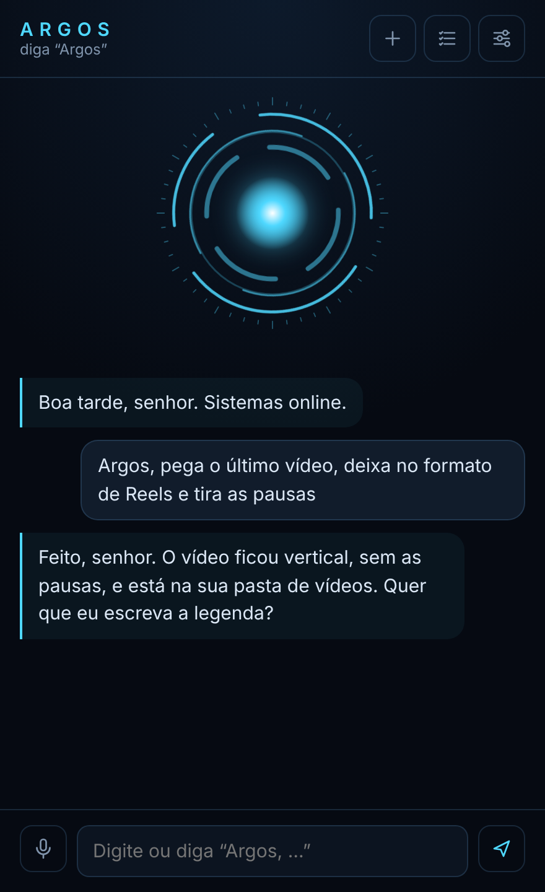

# Argos



**A.R.G.O.S.** — Agente de Redes sociais, Gestão, Otimização e Suporte.

Assistente pessoal de IA que **mora no seu computador** e funciona **de graça**: liga junto com o PC, ouve quando você diz
**"Argos"**, responde com **voz neural local** e age de verdade na máquina.

- **Sempre ligado**: inicia com o computador, fica na bandeja do sistema e num orbe flutuante por cima das janelas.
- **Voz**: "Argos, …" a qualquer momento, ou `Ctrl+Shift+J`, ou um clique no orbe. Ouvir e falar rodam no próprio PC (Whisper + Piper), sem custo.
- **Voz personalizada**: escolha entre as vozes prontas, ajuste a velocidade, ou coloque o seu próprio modelo de voz.
- **Controla o PC**: abre programas e sites, volume e mídia, bloquear/suspender/desligar, prints.
- **Arquivos**: acha, abre e cria arquivos nas pastas que você liberar. Nunca apaga nem sobrescreve.
- **Vê a tela**: "Argos, o que é esse erro?" e ele olha a tela para responder.
- **Edita vídeos**: corta, deixa vertical para Reels, tira as pausas, junta, acelera, extrai o áudio.
- **Instagram**: ideias, roteiros, legendas e calendário; com a conta conectada, métricas, publicação e agendamento.
- **Agenda e rotina**: Google Agenda, tarefas, lembretes falados e memória permanente do que você pedir para lembrar.
- **Grátis e privado**: a inteligência roda no seu PC com um modelo aberto (Ollama). Dá para trocar pelo Claude (pago) se quiser mais qualidade.

<br clear="right"/>

## Instalar

### 1. Ollama (o "cérebro", grátis)

Baixe e instale o [Ollama](https://ollama.com/download). Deixe ele aberto: é ele que roda o modelo de IA na sua placa de vídeo.
O Argos baixa o modelo sozinho na primeira vez (`qwen3-vl:8b`, cerca de 6 GB).

Recomendado: placa de vídeo com 8 GB (ex.: RTX 3060 Ti) e 16 GB de RAM. Em máquina mais fraca, troque o modelo por `qwen3-vl:4b` em Configurações.

### 2. Argos

**Instalador:** no GitHub, **Actions → Build apps → Run workflow**. Quando terminar, baixe o `.exe` (Windows) ou `.dmg` (macOS) nos artefatos e instale.

**Pelo código**, com Node.js 20+:

```bash
npm install
npm run desktop
```

`npm run build:win` (ou `build:mac` / `build:linux`) gera o instalador em `dist/`.

### Primeira vez

1. Abra o Argos. Ele baixa sozinho o modelo de IA (~6 GB), as vozes (~150 MB) e, na primeira vez que ouvir, o reconhecimento de fala (~80 MB). **Configurações** mostra o andamento.
2. Depois disso a conversa, a voz e o controle do PC funcionam offline e sem custo (Instagram e agenda continuam precisando de internet).
3. Diga *"Argos, bom dia"*.

### Usar o Claude no lugar (opcional, pago)

Em **Configurações → Inteligência**, escolha Claude e cole uma chave da API (https://console.anthropic.com). É cobrado por uso pela Anthropic.
Em troca, ele entende melhor pedidos complicados, erra menos ao usar as ferramentas e ganha pesquisa na internet.

O app instalado já se registra para **iniciar com o computador** (dá para desligar em Configurações ou no menu da bandeja).
Fechar a janela não encerra: ele continua na bandeja ouvindo. Para sair de vez: botão direito no ícone da bandeja → **Sair**.

## O que pedir

| Você diz | Ele faz |
|---|---|
| "Argos, abre o Spotify" / "pesquisa receita de pão no YouTube" | abre o programa ou o site |
| "aumenta o volume" / "pausa a música" / "bloqueia a tela" | controla o sistema |
| "acha aquele PDF do contrato" / "o que tem em Downloads?" | procura e abre arquivos |
| "olha minha tela, o que tem de errado aqui?" | captura a tela e analisa |
| "pega o último vídeo, deixa vertical e tira as pausas" | edita e salva um arquivo novo ao lado do original |
| "me dá 5 ideias de Reels pra essa semana" | mostra num cartão na tela, pronto para copiar |
| "como foi meu Instagram essa semana?" | lê as métricas da conta |
| "posta esse Reels com essa legenda" / "agenda pra amanhã às 18h" | publica ou agenda, depois do seu "sim" |
| "me lembra de beber água em 20 minutos" / "marca dentista quinta às 15h" | lembrete falado ou evento na agenda |
| "lembra que meu canal é sobre …" | guarda na memória permanente |

Conectar as contas: [Instagram](docs/instagram.md) · [Google Agenda](docs/google-agenda.md)

## Voz personalizada

Em **Configurações → Voz** dá para trocar a voz, a velocidade e ligar/desligar o efeito de comunicador.
O motor é o [Piper](https://github.com/rhasspy/piper), que roda no seu PC.

Para usar uma voz só sua, treine ou baixe um modelo Piper e coloque os dois arquivos (`nome.onnx` e `nome.onnx.json`)
na pasta de vozes mostrada em Configurações. Ele aparece na lista como "sua voz".
Use apenas a sua própria voz ou vozes que você tem permissão para usar.

Em **Configurações → Assistente** você também troca o nome (que é a palavra de ativação) e como ele te chama.

## Segurança e privacidade

- No modo local, suas conversas e as capturas de tela não saem do computador.
- Os tokens e a memória ficam só no seu computador (pasta de dados do app).
- O servidor interno só atende o próprio computador, e sites abertos no navegador não conseguem comandar o Argos.
- Arquivos: só dentro das pastas liberadas (Área de Trabalho, Documentos, Downloads, Imagens, Vídeos, Músicas e as que você adicionar). Ele cria arquivos novos, nunca apaga nem sobrescreve.
- Desligar/reiniciar o PC, publicar no Instagram e apagar compromissos só acontecem depois de você confirmar.
- A tela só é capturada quando o seu pedido envolve a tela.
- O áudio do microfone é transcrito no próprio PC. No modo Claude, o texto do pedido e as capturas de tela vão para a API da Anthropic.

## Limitações conhecidas

- O modelo local é menos esperto que o Claude: pode entender errado um pedido complicado ou escolher a ferramenta errada. Pedidos diretos funcionam melhor.
- No modo local ele não pesquisa na internet (pode abrir a busca no navegador para você).
- Enquanto o modelo está carregado, ele ocupa boa parte da memória da placa de vídeo; jogos e edição pesada ao mesmo tempo podem ficar lentos.
- O foco é **Windows**. No macOS e no Linux, abrir apps, arquivos, voz e vídeo funcionam, mas alguns controles do sistema (teclas de mídia no macOS, início automático no Linux) não.
- A palavra de ativação usa o Whisper local: em PC mais fraco, cada frase pode levar alguns segundos para ser entendida.
- Foto para o Instagram precisa estar num link público (regra da API); Reels pode sair direto do computador.
- Posts agendados dependem do computador ligado na hora.

## Estrutura

```
desktop/      app Electron: início automático, bandeja, orbe flutuante, captura de tela, atalho global
server/       servidor local
  index.js      conversa com a IA (streaming), execução das ferramentas, confirmações
  tools.js      definição das ferramentas      prompt.js   personalidade e contexto
  pc.js         apps, sites, sistema, arquivos  video.js    edição com ffmpeg
  tts.js        voz Piper                       instagram.js / google.js   contas
  local.js      IA local pelo Ollama            config.js   configurações e memória
public/       interface (janela principal e orbe)
docs/         guias de conexão
```

No modo Claude, o modelo padrão é `claude-opus-5-5` com esforço baixo, para respostas rápidas por voz (`ARGOS_MODEL` no `.env` troca).
Também dá para rodar só o servidor e usar pelo navegador (`npm start`, http://localhost:3000), sem orbe, captura de tela nem palavra de ativação automática.
